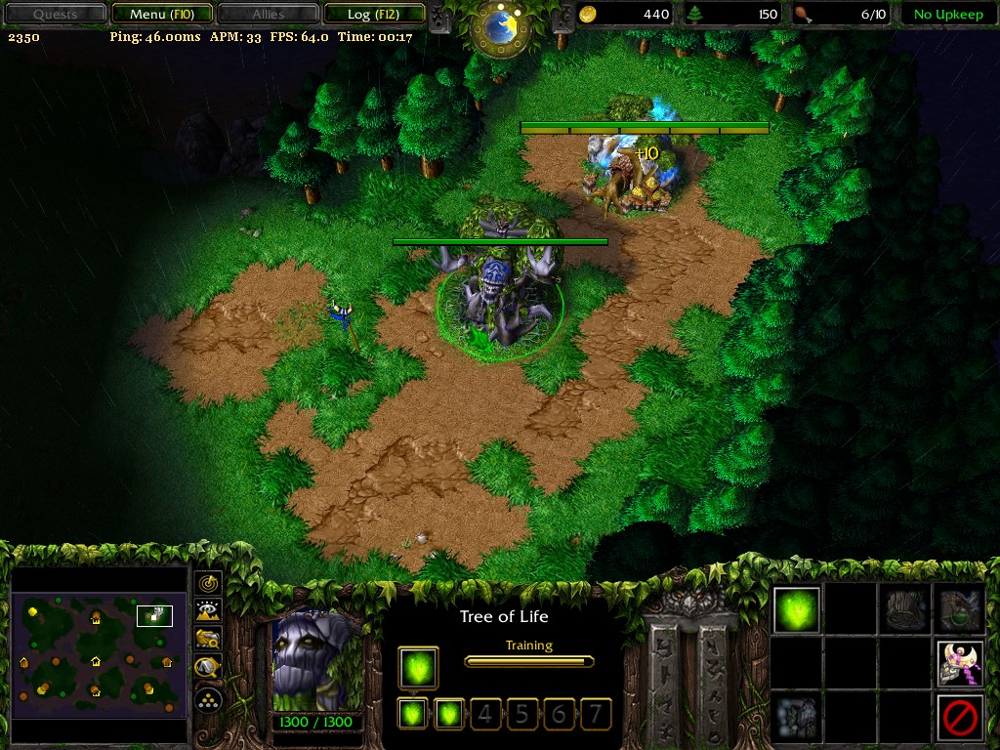

# ZoomHUD — зум камеры и HUD для Warcraft III 1.27b

Небольшая DLL (x86, ~40 КБ исходника) для **Warcraft III 1.27.1.7085**: управление дистанцией камеры
и компактная строка HUD с пингом, APM, FPS и таймером матча.

Проверено на версии **1.27b (1.27.1.7085)**, `Game.dll` 14 837 224 байт, Windows 10 x64.



---

## Об ограничении зума

В **Reforged** зум колёсиком — штатная функция, а с патча **1.33** есть настройка «Maximum zoom»
(игрок сам задаёт предел, ниже стандартного опустить нельзя). На ладдере **W3Champions** зум-аут
официально поддерживается. То есть в современной игре «увидеть больше карты» может любой желающий —
это не преимущество, а общее игровое поле.

Классический **1.27 такой функции не имеет**. Этот мод по сути даёт легаси-клиенту тот же паритет:
зум в пределах привычного максимума (по умолчанию `Max=3000`).

Что стоит держать в голове:

* на платформах и турнирах, где зум запрещён правилами (или где любой клиентский мод считается
  нарушением), использование — на ваш риск: мод грузится как DLL и по признакам неотличим от
  постороннего вмешательства для хоста/античита;
* значения выше штатного максимума (`Max>3000`) — уже территория, где вы видите больше остальных;
  использовать их стоит только в одиночной игре;
* мод не трогает видимость, ресурсы, юнитов и не даёт информации, которой нет на экране.

## Возможности

| Что | Как |
|---|---|
| Зум камеры | `Game.dll+0x211E00` (`f(int field, float* value, float* time)`, field 0) |
| Границы | по умолчанию 150…4050 (в оригинале ~1650…3000) |
| HUD | строка под верхней панелью: `2350   Ping: 48.00ms  APM: 23  FPS: 64.0  Time: 02:14` |
| Пинг | настоящий ICMP до пира игры (TCP-таблица процесса) или до хоста из конфига |
| APM | подсчёт нажатий/кликов за последние 60 с, только во время матча |
| FPS | по вызовам `EndScene` |
| Таймер | старт при входе в матч, пауза (F10) не сбрасывает, конец игры — сброс |

## Установка

DLL грузится как модуль игры. Два рабочих способа:

1. **Через `w3l.exe` + `wl27.dll`** (оконный загрузчик): положить файл в папку игры с любым именем `*.mix` —
   загрузчик подхватывает все такие файлы. Рекомендуемое имя: `wc3-zoomhud.mix`
   (проверено: мод грузится и работает под этим именем).
2. **Любым инжектором DLL** (например, обычный `LoadLibrary`-инжектор) — сразу после запуска игры.

Рядом с DLL создаются:

* `zoom.log` — диагностический лог (хуки, применение зума, состояния игры, ошибки);
* `ZoomHUD.ini` — настройки (создаётся вручную, см. пример `ZoomHUD.ini.example`).

## Настройки (`ZoomHUD.ini`)

```ini
[ZoomHUD]
Step=100          ; шаг изменения зума
Min=150           ; нижняя граница
Max=4050          ; верхняя граница
Start=2350        ; значение при запуске

KeyUp=33          ; PageUp
KeyDown=34        ; PageDown
KeyHold=35        ; End  — удержание зума
KeyHud=45         ; Insert — скрыть/показать HUD
SwallowKeys=1     ; не отдавать эти клавиши игре (иначе она крутит камеру ими же)

Font=12           ; размер шрифта HUD
FontFace=Georgia  ; шрифт
ColorR=255        ; цвет текста
ColorG=225
ColorB=120

X=8               ; позиция HUD
Y=30
Y2=30
Gap=105           ; отступ блока счётчиков от зума

Hold=0            ; 1 = держать зум постоянно
AutoHold=0        ; 1 = включать удержание, если игра сбросила камеру
ShowReal=1        ; показывать фактическое значение, если отличается

ShowApm=1
ShowPing=1
ShowTimer=1
PingEvery=2000    ; период замера пинга, мс
PingHost=8.8.8.8  ; резервный адрес, если у игры нет TCP-соединения (пусто = 0.00ms)
```

Клавиши — коды Virtual-Key (33 PageUp, 34 PageDown, 35 End, 36 Home, 45 Insert, 46 Delete, 112–123 F1–F12).

## Сборка

Visual Studio 2022 (x86 toolchain), без внешних зависимостей кроме системных библиотек:

```bat
call "C:\Program Files\Microsoft Visual Studio\2022\Community\VC\Auxiliary\Build\vcvars32.bat"
cl /nologo /TP /LD /O2 /MT /W3 /EHsc zoomhud.c /link /DLL /OUT:zoomhud.dll ^
   user32.lib gdi32.lib iphlpapi.lib ws2_32.lib dnsapi.lib winmm.lib dbghelp.lib
```

`/TP` обязателен: в C-режиме `d3d9.h` не отдаёт методы COM.

## Как это устроено

* **Зум** — вызов внутренней функции камеры `Game.dll+0x211E00` через 5-байтный inline-хук с трамплином.
  Вызов вне матча даёт исключение, поэтому есть проверка состояния.
* **Состояние игры** — цепочка `Game.dll+0xD46118 → +0x34 → +0x10 → +0x8 → +0x278`:
  `4` — идёт матч, `6` — пауза (меню F10), `0…3` — меню и загрузка.
* **HUD** — перехват `IDirect3DDevice9::EndScene` (в `d3d9.dll` это 7-байтный thunk, нужен хук на 7 байт),
  рисование через `GetBackBuffer → GetDC → TextOutA` в `__try/__except`.
* **Клавиши** — `WH_KEYBOARD_LL` в отдельном потоке: хук сам считает нажатия и гасит их, чтобы игра
  не использовала PageUp/PageDown/Insert для своей камеры. Работает только когда активно окно игры.
* **Пинг** — `GetExtendedTcpTable` (UDP-таблица Windows удалённый адрес не отдаёт) либо `PingHost`,
  замер `IcmpSendEcho` в отдельном потоке.
* **Корректный выход** — при выгрузке DLL исходные байты захуканных функций возвращаются на место,
  потоки останавливаются. Без этого игра падает при завершении (нефатально, но с окном ошибки Blizzard).

Подробности исследования (адреса, сигнатуры, грабли) — в `docs/notes.md`.

## Известные ограничения

* Внутренний лимит игры ~64 FPS при выключенном vsync — это не мод, а сам движок 1.27.
* Пинг в одиночной игре показывает значение до `PingHost` (в матче по UDP адрес пира недоступен системе).
* APM считается по вводу (нажатия и клики), а не берётся из внутреннего счётчика игры.
* Хук клавиатуры перехватывает четыре клавиши только при активном окне игры.

## Лицензия

MIT — см. [LICENSE](LICENSE).
